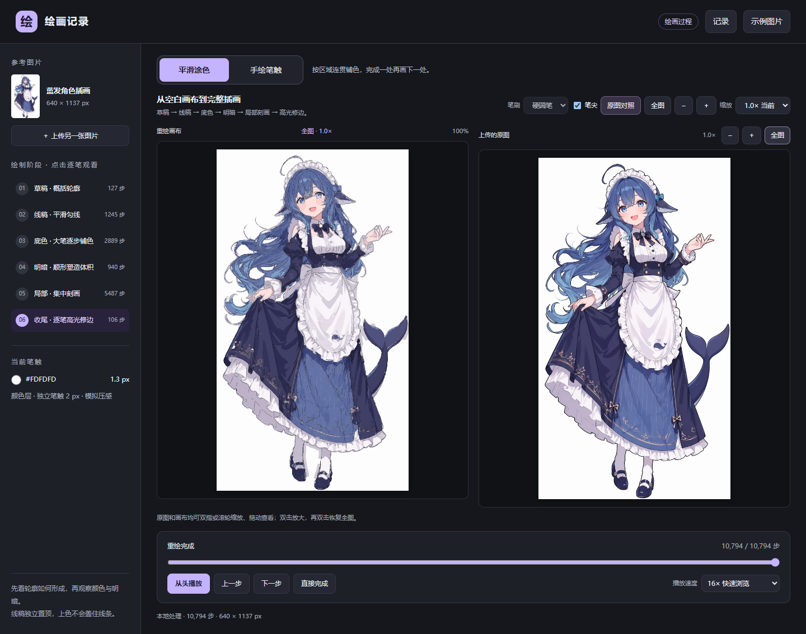
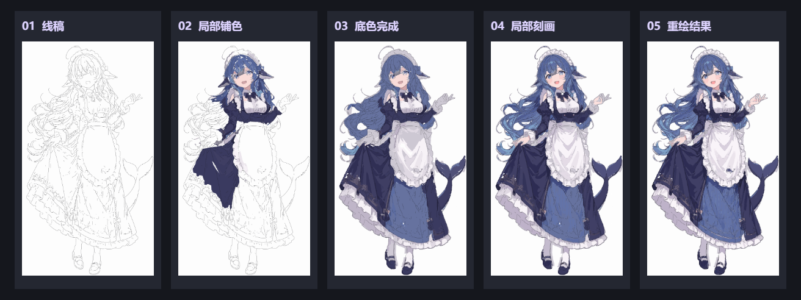
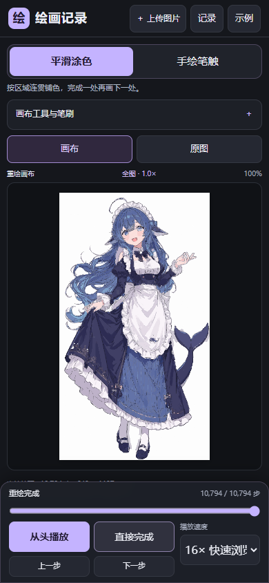

# 绘画记录

将上传的图片转换为可以逐笔播放的重绘过程。支持手机和电脑，在浏览器中完成图片分析、笔触规划和绘制，提供平滑涂色与手绘笔触两种风格。

项目使用 Vite、原生 JavaScript、Canvas 2D、Web Worker 和 Express。无需 Python、模型权重或外部 AI API。



> 当前生成的是算法模拟的重绘过程，不能恢复原作者真实的作画顺序、笔压或图层。颜色归并、轮廓提取与笔刷近似会造成细节偏差，不保证与原图逐像素一致。

## 绘制过程预览

以下为内置示例的实际绘制截图，依次展示线稿、局部铺色、底色完成、局部刻画和重绘结果。



## 手机端预览

手机端将原图与画布分开展示，底部保留播放、进度和倍速控制。



## 功能

- 上传本地图片，解析为可重复播放的绘制步骤。
- 平滑涂色：草稿 → 线稿 → 底色 → 明暗 → 局部刻画 → 高光修边。
- 手绘笔触：模拟起收笔、压感和笔刷纹理。
- 播放、暂停、逐步前进或后退、进度跳转、阶段播放和直接完成。
- 多档倍速；笔尖旁与侧栏显示当前颜色的 HEX 色号。
- 画布和原图独立缩放、拖动，播放时保持手动视角。
- 本机绘画记录、刷新恢复、解析结果复用，以及长按或右键删除记录。
- 响应式布局，支持同一局域网内的手机访问。

目前没有账号、跨设备同步或导出界面。

## 快速开始

需要 Node.js **22.12 或以上**，建议使用 Node.js 24。以下命令在项目根目录执行：

```sh
npm ci
npm run build
npm start
```

电脑打开 [http://localhost:8766/](http://localhost:8766/)。正式服务默认监听 `0.0.0.0:8766`，启动日志会列出局域网地址。保持服务运行，按 `Ctrl+C` 停止。

`npm start` 使用已有的 `dist/`，修改源码后需要重新执行 `npm run build`。

### 手机访问

1. 手机和电脑连接同一个 Wi-Fi 或可互通的局域网。
2. 在启动日志中找到 WLAN 或实际使用网卡的 IPv4 地址。
3. 手机浏览器打开 `http://电脑IP:8766/`。

手机上的 `localhost` 或 `127.0.0.1` 指向手机自身。访问不通时，检查电脑服务是否仍在运行、Windows 防火墙是否允许 Node.js 的专用网络访问，以及路由器是否启用了访客网络隔离。

### 修改监听地址和端口

正式服务支持 `HOST` 和 `PORT` 环境变量。PowerShell 示例：

```powershell
$env:HOST = '0.0.0.0'
$env:PORT = '9000'
npm start
```

macOS / Linux：

```sh
HOST=0.0.0.0 PORT=9000 npm start
```

开发服务也支持 `PORT`，监听地址由 `vite.config.mjs` 配置。项目没有自动读取 `.env` 的逻辑，请通过运行环境传入服务变量。

## 使用方式

上传 PNG 或 JPG 图片后等待解析完成，再开始播放。当前限制单文件不超过 20 MiB，处理前会将图片长边缩小到最多 1137 像素。

页面默认使用 16× 快速浏览。点击某个绘制阶段，会跳到该阶段起点并以 1× 开始播放；暂停后可逐步查看，或拖动进度条跳转。

1× 包含落笔、行笔、抬笔移动及换色等待，是模拟节奏，并非真人速度测量。4×、16× 等倍率使用同一时间基准；64× 及以上省略抬笔等待。可以使用“直接完成”查看结果。

在“记录”中可以重新打开已处理的图片。手机长按记录约半秒，或电脑右键点击记录，可打开删除确认。

## 绘制原理

当前实现使用图像处理与规则规划，没有调用学习型绘画模型。

1. **图片分析**：在 Web Worker 中进行颜色归并、连通区域和轮廓提取，减少主页面阻塞。
2. **草稿与线稿**：提取暗色脊线，细化为中心线，再简化、平滑为曲线路径。
3. **多尺度铺色**：先建立粗色调，再加入约 24 色的中间层，最后使用最多 80 色的细节层。
4. **顺形运笔**：根据区域整体和局部形状方向生成路径；在边界或方向明显变化处收笔。
5. **局部排序**：结合空间距离、工作区域和换色代价，尽量连续处理相邻位置。
6. **覆盖与修边**：用未覆盖单元估计需要补画的位置，逐笔更新覆盖情况；部分狭长修边通过中心线路径完成。

播放时使用保存的笔触路径、笔宽和颜色，在 Canvas 上逐步绘制。草稿、线稿和颜色分别放在独立图层，填色不会盖住线稿。宽色面仍使用颜色区域遮罩限制笔触边界；部分细线不使用遮罩。没有用原图贴图替代落笔过程。

覆盖残差是区域内的几何估计，并不是逐像素比较最终画布与原图的完整优化器。局部顺序也未识别人物、头发或衣服等语义，复杂插画、渐变和细小装饰仍可能出现偏差。

## 本机记录与隐私

用户上传的图片、解析结果和记录保存在当前浏览器的 IndexedDB 中，不上传到 Express 服务；服务只提供网页和示例资源。

- 正常刷新或重新打开记录时，会复用已保存的解析结果。
- 首次切换未生成的绘画风格，或算法版本升级时，可能需要额外解析一次。
- 不同设备、浏览器，以及不同协议、域名/IP 或端口使用独立存储。
- `localhost` 和局域网 IP 是不同地址，记录不会自动互通。
- 清除网站数据、无痕窗口结束或浏览器存储回收可能导致记录丢失；当前没有备份与同步功能。

若提示本机记录读取失败，检查网站存储权限，关闭占用记录的旧标签页后点击“重新读取”。空间不足时可删除不需要的记录。

## 开发

```sh
npm ci
npm run dev
```

开发地址默认同样为 [http://localhost:8766/](http://localhost:8766/)，源码修改后会自动刷新。开发服务和正式服务不能同时占用同一端口。

### 更新示例

修改规划算法不会自动重建示例数据。只修改平滑涂色规划时运行：

```sh
npm run samples:fill
npm run build
```

修改图片分析、轮廓提取或两种风格共有的数据时，重新生成两种示例：

```sh
npm run samples
npm run build
```

示例生成使用无头浏览器，耗时取决于图片和设备。开发和构建命令会自动准备带内容哈希的示例资源，构建后生成 gzip / Brotli 文件。

### 更新 README 截图

先构建，再截取真实桌面页面、手机页面与五个绘制时刻：

```sh
npm run build
node scripts/readme-screenshots.cjs
```

图片保存在 `docs/images/`，需与 README 一起提交到 Git。脚本使用临时本地服务和独立浏览器会话，不读取已有的个人记录。

## 测试

先构建，再运行测试；不要同时运行构建和测试，以免测试读取正在替换的资源。

```sh
npm run build
npm test
npm run test:e2e
npm run test:human
npm run test:brush
npm run test:finish
npm run test:speed
```

| 命令 | 检查内容 |
| --- | --- |
| `npm test` | HTTP 路由、私有文件隔离、压缩缓存与播放计时 |
| `npm run test:e2e` | 手机/桌面布局、真实上传解析、重放、缩放、缓存、记录恢复与删除 |
| `npm run test:human` | 样例笔触数量、笔宽层级、碎笔、无遮罩修边与最终颜色误差 |
| `npm run test:brush` | 部分笔触预览、背景合成、色号与暂停稳定性 |
| `npm run test:finish` | 修边逐笔增长、阶段起点、快放与固定视角 |
| `npm run test:speed` | 1× 运笔、抬笔等待和倍速行为 |

浏览器测试自行启动临时 Node 服务。Windows 优先使用已安装的 Edge；没有可用浏览器时执行：

```sh
npx playwright install chromium
```

也可通过 `BROWSER_EXECUTABLE` 指定浏览器可执行文件。截图等测试输出位于 `test-results/`，不纳入 Git。

## Docker 部署

```sh
docker compose up -d --build
docker compose logs -f
```

访问主机的 `8766` 端口。容器使用 Node.js 24，以非 root 用户运行，配置了健康检查和 `unless-stopped` 重启策略。

```sh
curl http://localhost:8766/healthz
```

正常返回：

```json
{"status":"ok","app":"drawing-records"}
```

需要其他外部端口时，修改 `compose.yaml` 中的端口映射，例如 `9000:8766`。可在外部使用反向代理提供域名与 HTTPS。

`dist/` 也可部署到 Nginx 或静态托管平台，当前配置要求部署在站点根路径。静态部署不包含 Express 的 `/healthz` 和旧路径兼容路由，预压缩资源也需由托管平台配置支持。

## 项目结构

```text
.
├── index.html                  # 页面结构
├── src/
│   ├── main.js                 # 交互与播放入口
│   ├── worker.js               # 图片分析 Worker 入口
│   ├── playback-timing.js      # 运笔与抬笔计时
│   ├── styles.css              # 桌面与手机样式
│   └── runtime/                # 分析、曲线、笔触规划、渲染、手势和存储
├── server/                     # Express 正式服务
├── scripts/                    # 示例生成、资源准备和预压缩
├── samples/                    # 示例原图与两种风格的解析结果
├── tests/                      # 服务与浏览器测试
├── docs/                       # 项目文档
├── Dockerfile
├── compose.yaml
└── vite.config.mjs
```

`scripts/drawing-runtime.mjs` 在编译时组合共享作用域的运行时代码，分别打包页面和 Worker，不使用运行时 `eval`。修改 `src/runtime/` 后无需手动拼接文件。

`samples/` 是构建输入，需要随项目保留。`dist/`、`.generated/`、`public/assets/`、`node_modules/` 和 `test-results/` 是生成内容，已由 `.gitignore` 排除。`work/` 与 `outputs/` 仅保留迁移前的本地实验文件，正式系统不依赖它们。

正式服务兼容旧书签 `/biji-repaint.html` 和 `/biji-web.html`。
